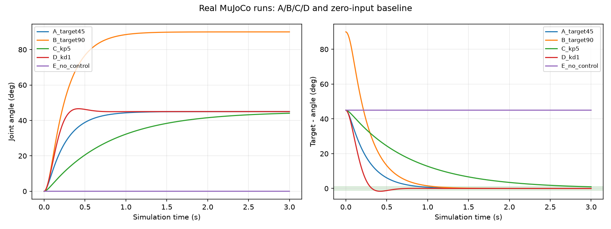
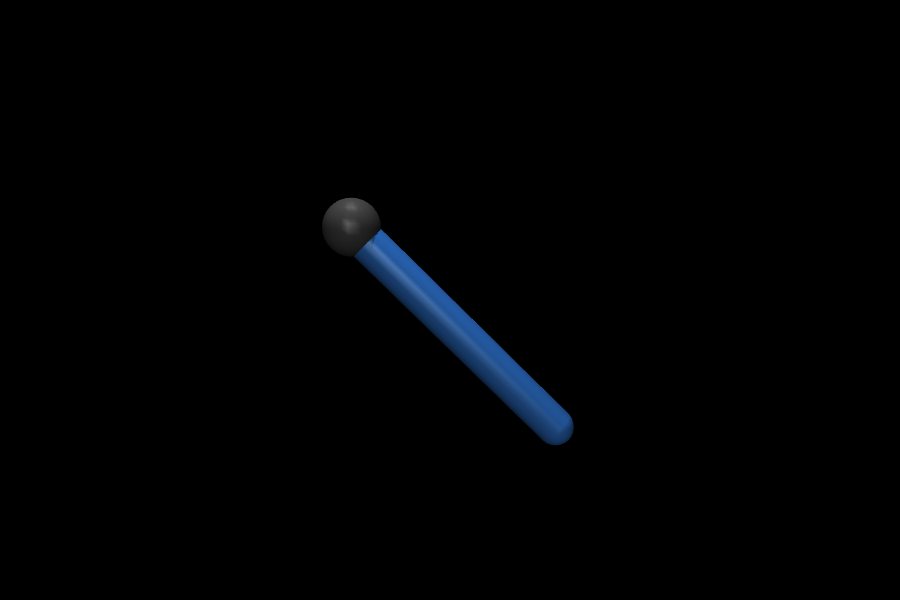

# 실제 실행 결과

수행일: 2026-10-29 (Asia/Seoul). 아래 수치는 실제 MuJoCo 3.17.0 계산 결과다.
손으로 만든 예상 궤적이나 단순 수학 애니메이션으로 대체하지 않았다.

## 확인한 환경

- Windows 11, build 26200 / x86-64
- Python 3.13.7
- MuJoCo 3.17.0 / NumPy 2.5.4 / Matplotlib 3.11.2 / pytest 9.2.0
- `pip check`: No broken requirements found.
- GPU 모델·드라이버 정보: CIM 조회 제한으로 미확인.
- 실제 로봇 하드웨어 연결: 수행하지 않음.

## 제어 실험

모든 행은 독립된 초기 상태(각도 0 rad, 각속도 0 rad/s), 중력 0에서 시작했다.
3초, timestep 0.002초, 1500스텝, 모터 토크 범위 ±10 N·m를 사용했다.

| 실험 | 목표 | 최종 각도 | 최종 오차 | 마지막 0.5초 최대 절대 오차 | 오버슈트 | 판정 |
| --- | ---: | ---: | ---: | ---: | ---: | --- |
| A: Kp=15, Kd=3 | 45° | 44.999879° | 0.000121° | 0.001053° | 0° | 통과 |
| B: Kp=15, Kd=3 | 90° | 89.999739° | 0.000261° | 0.002279° | 0° | 통과 |
| C: Kp=5, Kd=3 | 45° | 44.057763° | 0.942237° | 1.807261° | 0° | 미통과 |
| D: Kp=15, Kd=1 | 45° | 45.000000° | -2.85e-9° | 9.52e-8° | 1.610375° | 통과 |
| E: 제어 입력 0 | 45° | 0° | 45° | 45° | 0° | 미통과 |

판정은 「3초 전체 실행 + 마지막 0.5초의 모든 표본이 ±1도 이내」라는 교육용 기준이다.
실제 로봇·산업용 제어기의 인증 기준으로 사용할 수 없다. 전체 정밀 수치는
`results/summary.csv`와 각 실험의 `metrics.json`에 보관했다.

## 결과 해석

- A/B는 목표각 주변으로 접근하고 설정한 기준을 만족했다. 90도 실험에서는
  토크가 제한된 스텝 비율이 약 2.07%로, 45도 기본 실험의 약 0.27%보다 컸다.
- C는 최종 순간에는 1도 이내였지만 마지막 0.5초 전체의 기준을 만족하지 못했다.
  실행 구간에서 ±1도로 들어와 끝까지 유지한 시점은 약 2.956초였다.
  이는 실행 실패나 수치 발산이 아니라 지정된 시간 내 평가 기준 미달이다.
- D는 약 1.61도 오버슈트 후 목표에 접근했다. D를 줄였을 때의 감쇠 차이가
  이 조건에서 관측됐다. 모든 모델·이득에서 같은 응답이 나온다는 결론은 아니다.
- E는 중력·초기 속도가 0인 이번 모델에서 움직이지 않았다. 제어 입력이 없을 때의
  기준 방법이며, 실제 로봇이나 중력이 있는 모델이 정지한다는 뜻이 아니다.

## GUI와 3D 확인

`main.py --target 45 --viewer --output results/viewer45`를 실제 실행했다.
`launch_passive`가 초기화되고 1500스텝을 완료한 뒤 정상 종료했다(exit code 0).
GUI 실행의 최종 각도는 44.99987923276542°로 GUI 없는 기본 실험과 같았다.
이 기록은 API·그래픽 창 초기화 및 루프 완료의 확인이며, 사람의 육안 검수 기록이나
GPU 드라이버 식별 결과가 아니다. 사용자 화면을 캡처한 것으로 주장하지 않는다.

`results/arm_3d.png`는 동일 초기 상태에서 기록된 입력을 실제 물리 엔진으로 재실행한 뒤
MuJoCo Renderer로 그린 최종 상태다. 데스크톱 뷰어 스크린샷이나 AI 생성 이미지가 아니다.

## 검증

첫 테스트 실행: `13 passed in 9.11s`.

- XML 컴파일, 관절·구동기 수와 timestep 확인.
- ctrl 변경 직후 상태가 순간 이동하지 않으며 mj_step 이후 물리 상태가 변하는지 확인.
- 45도, 90도, -45도에서 목표 접근·토크 제한 확인.
- 같은 조건 재실행의 상태 기록 일치 및 제어 없는 기준 동작 확인.
- 범위 밖 목표, 비유한 값, 음수 이득, 0 또는 지나치게 짧은 실행시간 거부 확인.
- joint만 삭제했을 때의 잘못된 motor 참조와 joint/motor를 함께 삭제한 고정 모델 확인.
- CSV 시간·상태 정합성, JSON, PNG 파일 생성 확인.

## 근거 연결

사용자 OpenCrab 팩의 상태/입력 구분, 초기조건·단위·시간 기록, 실패를 포함한 비교 평가
기준을 적용했다. 원문 근거의 공개용 요약은 `evidence/pack_evidence.json`에 있다.
구현과 수치 실험은 이번 작업에서 수행한 것이며 팩에 이미 있던 실험 결과가 아니다.
첨부의 끊어진 Python 코드와 확인 문제의 joint 삭제 예외를 보완했다.

모델·제어·실험 코드는 제공했으나 정책 학습, 강화학습·VLA 연결, 실물 전이는 수행하지 않았다.
